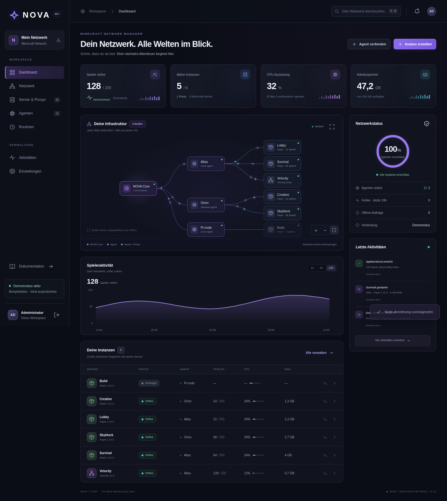

# NOVA

**Dein Netzwerk. Alle Welten im Blick.**

Eine Minecraft-Netzwerkverwaltung mit Python-Zentrale, separaten Agenten und einer dunkelblau-violetten Weboberfläche. Kein Node.js, kein Frontend-Build, kein Docker-Zwang. Zentrale und Agent laufen auf Windows und Linux; der Agent auch auf einem Raspberry Pi mit 64-Bit-Linux.



## Schnellstart

Voraussetzung: **Python 3.11+**, auf Agenten zusätzlich **Java 21+**. Neueste Minecraft-Versionen können Java 25 erfordern; die konkrete Java-Anforderung der gewählten PaperMC-Version beachten. Ein Pi benötigt eine zum Betriebssystem passende ARM64-Java-Laufzeit und ausreichend RAM.

Repository klonen oder als ZIP herunterladen und entpacken. Im NOVA-Verzeichnis:

```sh
python install.py
```

Unter Windows kann `py install.py` statt `python install.py` verwendet werden. Auf Debian/Ubuntu ist gegebenenfalls zuerst `python3-venv` zu installieren. Der Installer erstellt `.venv`, prüft die Paket-Hashes aus `requirements.lock`, installiert das Paket und startet die Zentrale auf Port 8000. Das **einmalig angezeigte Admin-Passwort** im Terminal sicher speichern. Das Panel lokal über den Browser auf Port 8000 öffnen.

Eine vollständig getrennte Demonstration mit drei Beispielagenten, sechs Instanzen und simulierten Metriken:

```sh
python install.py --demo
```

Die Demo ist **ohne Anmeldung** zugänglich, startet keine Java-Prozesse, lädt keine Minecraft-Software herunter und lässt keine Agentenkopplung zu. Dateiaktionen bearbeiten ausschließlich Beispieldateien unter `.nova/demo-files/`. Nicht als produktive Zentrale verwenden.

### Später erneut starten

Linux / Raspberry Pi:

```sh
.venv/bin/python -m nova serve
```

Windows:

```powershell
.venv\Scripts\python.exe -m nova serve
```

`--host`, `--port` und `--data` sind konfigurierbar. Standardmäßig bindet NOVA nur an `127.0.0.1`. Für externen Zugriff die Zentrale hinter einem **HTTPS-Reverse-Proxy** betreiben. `--host 0.0.0.0` nur bewusst in einem geschützten Netzwerk verwenden. Uvicorns Proxy-Header nur für tatsächlich vertrauenswürdige Reverse-Proxys konfigurieren; Host-/Origin-Weiterleitung muss zusammenpassen.

Passwort lokal ändern (meldet vorhandene Sitzungen ab):

```sh
.venv/bin/python -m nova password
```

Alternativ kann `NOVA_ADMIN_PASSWORD` beim **ersten** Start gesetzt sein. Es wird nur als gesalzener scrypt-Hash gespeichert. Passwörter nicht in Startskripte oder das Repository schreiben.

## Agenten verbinden

1. Zentrale ohne `--demo` starten und anmelden.
2. Unter **Agenten → Agent verbinden** einen einmaligen Kopplungscode erzeugen. Er ist zehn Minuten gültig.
3. NOVA auf dem Zielgerät klonen/entpacken, Python und Java installieren.
4. Auf dem Zielgerät ausführen:

```sh
python install.py --agent --url https://nova.example.com
```

Der Agent fragt verdeckt nach dem Code. Nach der Kopplung speichert er seinen Schlüssel in `.nova/agent/connection.json`. Für einen expliziten, vom Proxy erreichbaren Hostnamen oder eine private IP:

```sh
.venv/bin/python -m nova agent \
  --url https://nova.example.com \
  --name Atlas \
  --address 10.0.0.11
```

Unter Windows `.venv\Scripts\python.exe` verwenden. `--address` wird bei der **ersten Kopplung** gespeichert. Zum Wechseln einer Zentrale oder Adresse einen Agenten ohne Instanzen entfernen und mit einem neuen Datenverzeichnis koppeln. `--data` erlaubt mehrere getrennte Agenten; `--java` wählt eine bestimmte Java-Datei aus.

Für einen ausdrücklich vertrauenswürdigen HTTP-LAN-Test kann der Agent mit `--allow-http` gestartet werden (nach `install.py --no-start` direkt den Agenten aufrufen). Außerhalb lokaler Tests HTTPS nutzen. TLS- und Download-Prüfungen bleiben aktiv.

Der Agent benötigt **keinen eingehenden Verwaltungsport**: Er holt Aufträge ausgehend von der Zentrale ab. Die Minecraft-Spielports müssen dagegen entsprechend der Netzwerktopologie freigegeben werden. Agenten als **dedizierte Benutzer ohne Administrator-/Root-Rechte** ausführen, da heruntergeladene Server und Plugins mit den Rechten des Agenten laufen.

### „Connection refused“ beim Agentenstart

Die Installation kann erfolgreich sein, obwohl der anschließende Verbindungsaufbau fehlschlägt. `127.0.0.1` und `localhost` bezeichnen immer **das Gerät, auf dem der Agent läuft**. Ein Agent auf dem Pi erreicht darüber keine Zentrale auf deinem Windows-PC oder einem anderen Server. Die Zentrale und der Agent sind zwei getrennte, gleichzeitig laufende Prozesse.

Wenn beide auf demselben Linux-Rechner laufen, im ersten Terminal die Zentrale starten und laufen lassen:

```sh
cd ~/NOVA
.venv/bin/python -m nova serve
```

An der Zentrale anmelden und einen Kopplungscode erzeugen. Dann im **zweiten Terminal** auf demselben Rechner:

```sh
cd ~/NOVA
.venv/bin/python -m nova agent --url http://127.0.0.1:8000
```

Läuft die Zentrale auf einem anderen Gerät, dessen tatsächlich erreichbare HTTPS-Adresse verwenden. Nur für einen Test im vertrauenswürdigen LAN kann die Zentrale ausdrücklich an `0.0.0.0` gebunden werden (`nova serve --host 0.0.0.0`); den Agenten dann mit `--url http://IP-DER-ZENTRALE:8000 --allow-http` starten. `IP-DER-ZENTRALE` ist durch die echte IP zu ersetzen. Auf dem Zentralenrechner muss die Firewall Verbindungen auf diesen Port erlauben. `0.0.0.0` selbst ist keine Agenten-Zieladresse. Eine bestehende Zentrale muss nicht ein zweites Mal gestartet werden, sondern mit den passenden Bindungsparametern laufen.

NOVA prüft beim Agentenstart jetzt zuerst `/health`, meldet eine unerreichbare oder im Demomodus gestartete Zentrale verständlich und fragt erst danach nach dem Kopplungscode. Ein verweigerter Verbindungsaufbau wird nicht durch erneutes Installieren oder einen anderen Code behoben. Bereits installierte Agenten direkt mit dem oben angegebenen `.venv`-Python starten.

## Ein Minecraft-Netzwerk aufbauen

1. Agent(en) verbinden und ihre vom Proxy erreichbaren Adressen prüfen.
2. **Instanz erstellen**: Velocity als Einstiegspunkt und mindestens einen Paper-Server wählen. Software, Version, Agent, Port und RAM festlegen. Die Paper-Installation erfordert die Zustimmung zur Minecraft-EULA.
3. Der Agent fragt den offiziellen PaperMC-Katalog ab, lädt den Build herunter und überprüft seinen SHA-256-Hash. Die Installation startet die Instanz noch nicht.
4. Alle Instanzen stoppen, dann **Netzwerk → Netzwerk verknüpfen**. NOVA sichert und schreibt `velocity.toml`, `forwarding.secret`, `server.properties` und die Velocity-Sektion in `config/paper-global.yml`. Vorherige Konfigurationen erhalten den Zusatz `.nova-before-network`; spätere Synchronisationen ersetzen diese letzte Sicherung. **Die Velocity-Datei wird vollständig neu erzeugt**, eigene Velocity-Einstellungen vorher zusätzlich sichern.
5. Dadurch aktiviert NOVA **Velocity Modern Forwarding** mit einem gemeinsamen Geheimnis und schaltet die Paper-Backends auf `online-mode=false`. **Vorher per Firewall sicherstellen, dass ausschließlich die Proxys die Paper-Spielports erreichen können.** Das Panel konfiguriert keine Firewalls. Nur Velocity wird öffentlich erreichbar gemacht und authentifiziert Minecraft-Konten.
6. Zuerst Paper-Server, dann Velocity starten. Konsole und echte Spielerverbindung prüfen. Der erste Paper-Server in der Routenliste ist das Fallback-Ziel. Weitere Velocity-Anpassungen sind im Dateieditor möglich.

NOVA verwaltet die zentrale Konfiguration für **ein Netzwerk** mit mehreren Proxys und Backends. Die Netzwerkkarte zeigt Verwaltungsbeziehungen (Core → Agent → Instanz), nicht die tatsächlichen Minecraft-Routingpfade. Die Verbindungspunkte zeigen aktive Verbindungen an; sie sind **keine Paket- oder Bandbreitenmessung**. Ihre Positionen bleiben im Browser gespeichert; Doppelklick bzw. Enter öffnet Details. Für große Flotten ist noch kein automatisches Graph-Clustering implementiert.

## Funktionen

- Dashboard: Spieler, Online-Instanzen, mittlere Agenten-CPU, Host-RAM, Agentenerreichbarkeit, Fehler und Aktivitäten.
- Spielerzahlen über Minecraft-Status-Pings. Wenn Velocity läuft, werden Proxy-Spieler gezählt, sonst Paper-Spieler. Bei mehreren voneinander unabhängigen Proxys können Spieler während eines Wechsels kurz doppelt erscheinen. TPS werden nicht erfunden: Ohne Minecraft-Metrikplugin gibt es noch keine echten TPS-Werte.
- Interaktive SVG-Netzwerkkarte mit Drag & Drop, Zoom und abschaltbarer Bewegung; respektiert reduzierte Bewegung des Betriebssystems.
- Start, sauberer Stopp, Neustart, begrenzte Konsolenausgabe (letzte 400 Zeilen im Agentenprozess) und Minecraft-Konsolenbefehle. Keine Shell-Befehlsausführung durch das Panel.
- Dateibrowser pro Instanz, UTF-8-Editor, Datei-/Ordnererstellung, Upload und Löschen. Text/Upload maximal **1 MB**, leere Ordner löschbar, kein rekursives Löschen. Große JARs/Welten über das Betriebssystem übertragen. Symlinks und Pfade außerhalb der Instanz sind gesperrt. Änderungen an laufenden Serverkonfigurationen werden üblicherweise erst nach einem Neustart wirksam.
- Konsistente ZIP-Backups **gestoppter** Instanzen, ohne `server.jar`, auf dem jeweiligen Agenten. Wiederherstellung und Download großer Backups erfolgen derzeit lokal, bei gestoppter Instanz.
- Wiederkehrende Start-/Stopp-/Neustart-/Backup-Routinen mit Minutenintervall. Erster Lauf nach dem Intervall. Die Zentrale muss laufen. Offline-Agenten werden protokolliert; verpasste Ausführungen werden nicht mehrfach nachgeholt. Kombinierte transaktionale Stop-Backup-Start-Routinen sind noch nicht enthalten.
- Gehashte Zugangsschlüssel, einmalige Kopplung, HttpOnly-/SameSite-Sitzungen, Anmeldebegrenzung und Origin-Prüfung. Ein Administrator, noch keine Mandanten, Rollen oder 2FA.
- SQLite-Persistenz, dauerhafte Jobwarteschlange und Ergebnis-Outbox beim Agenten. Bestätigte Aufträge werden nicht erneut ausgeführt. Wird ein Agent während eines Auftrags hart beendet, kann dessen Ergebnis unbekannt bleiben; solche Aufträge werden nach 15 Minuten als fehlgeschlagen markiert und **nicht automatisch erneut ausgeführt**.

Ein laufender Java-Prozess bedeutet nicht automatisch, dass Minecraft schon vollständig gestartet ist. Ein noch nicht antwortender Status-Ping wird als Startphase gemeldet. Agenten ohne Heartbeat werden nach 30 Sekunden als offline angezeigt; alte Instanzmetriken werden dann ausgeblendet.

## Dauerbetrieb

Der Installer startet im Vordergrund; er installiert nicht unbemerkt einen Systemdienst. Live-Prozesse überleben keine Maschinen-Neustarts. Beispiele befinden sich in [deploy/](deploy/):

- Linux: systemd-Dienste für Zentrale und Agent, mit anzupassenden Pfaden und Benutzern.
- Windows: PowerShell-Skript zum Anlegen einer Aufgabe im Benutzerkontext. Die Aufgabe läuft bei Anmeldung weiter und startet nach einem Fehler neu. Für Betrieb schon vor einer Anmeldung einen eigenen Dienst über die Windows-Administration einrichten.

Beim normalen Beenden stoppt der Agent seine Java-Prozesse. Nach einem Absturz erkennt er von ihm erzeugte, noch laufende Java-Prozesse über PID, Startzeit und Instanzkennzeichnung und beendet sie kontrolliert. Instanzen starten danach nicht von selbst. Agenten immer mit dem gleichen Datenverzeichnis weiterbetreiben.

Zentrale und Agent speichern unter `.nova/` (mit `--data` änderbar):

```text
.nova/
  nova.sqlite               # Zentrale: Adminhash, Sitzungen, Agenten, Aufträge, Routinen
  demo.sqlite               # Getrennte Demodatenbank
  demo-files/               # Nur Demo-Dateien
  agent/
    connection.json         # Sensibler Agentenschlüssel, nicht weitergeben
    instances.json          # Installierte Instanzen und Prozesszuordnung
    job-results.json        # Noch nicht bestätigte Ergebnisse
    servers/<id>/           # JAR, Welten, Konfigurationen, Plugins
    backups/<id>/*.zip      # Lokale Backups
```

Datenverzeichnisse nicht ins Git-Repository aufnehmen oder öffentlich freigeben. Linux-Dateimodi für Agentenschlüssel werden auf `0600` gesetzt; unter Windows zusätzlich passende Verzeichnis-ACLs setzen. Zentrale inklusive SQLite-Datenbank regelmäßig sichern. Die v0.1.0 hat noch keine Datenbankmigrationen oder Hochverfügbarkeit; mehrere Zentralen dürfen nicht gleichzeitig dieselbe Datenbank betreiben.

### Benötigter Netzwerkzugriff

- Python-Installation: `pypi.org`, `files.pythonhosted.org`.
- Offizieller Versionskatalog auf der Zentrale: `fill.papermc.io`.
- Agentendownloads: `fill.papermc.io`, `fill-data.papermc.io` (bzw. offiziell gelieferte `api.papermc.io`-URLs).
- Agent → konfigurierte Zentrale über HTTPS.
- Paper/Velocity können beim Erststart weitere offizielle Minecraft-/Bibliotheksdownloads benötigen, etwa `piston-data.mojang.com`, `libraries.minecraft.net`, Maven-Repositories. Die konkrete Konsolenausgabe beachten.

In verwalteten Cloud-Umgebungen müssen diese Ziele in der bestehenden Netzwerkfreigabe erlaubt sein. NOVA umgeht keine Proxy-, TLS- oder Prüfsummenprüfung. Ohne PaperMC-Zugriff zeigt die UI einen Katalogfehler, statt ungeprüfte Downloads anzubieten.

## Entwicklung und Tests

```sh
python install.py --no-start
.venv/bin/python -m unittest discover -s tests -v
.venv/bin/python -m nova serve --demo
```

Die Tests prüfen echte HTTP-API-Abläufe inklusive Anmeldung/Kopplung, Agentenberechtigungen, Aufträgen, Dateischutz und Java-Prozesssteuerung mit einem kontrollierten Testprozess. Sie benötigen keinen Minecraft-Download. Ein tatsächlicher Paper-/Velocity-Start samt Minecraft-Client ist eine zusätzliche Integration, die Java und den oben beschriebenen Netzwerkzugriff benötigt.

Wenn ein Java-21-JDK mit `javac` installiert ist, wird zusätzlich eine kleine Java-Konsolenanwendung gebaut und durch den echten Agenten installiert, gestartet, angesprochen, neu gestartet und sauber beendet. Ohne JDK wird genau dieser Test ausdrücklich übersprungen. Die GitHub-Actions-Konfiguration führt die Tests mit Java 21 auf Linux und Windows unter Python 3.11, 3.12 und 3.13 aus; sie veröffentlicht und deployt nichts.

Die lokalen Backend-/Agententests einschließlich des echten JVM-Tests sind bestanden; zusätzlich wurde der Desktop-/Mobilablauf in Chromium geprüft. Regressionstests stellen einen tatsächlich verweigerten Verbindungsaufbau nach und prüfen, dass dabei weder ein Kopplungscode abgefragt noch ein Traceback ausgegeben wird. Echte PaperMC-Downloads und Minecraft-Serverstarts konnten wegen der Netzwerkfreigabe der Cloud-Umgebung nicht ausgeführt werden. Die Windows-Matrix wird erst durch GitHub Actions überprüft; sie wurde hier nicht lokal ausgeführt.

Optionaler Browser-Smoke-Test: Playwright und Chromium separat installieren, Demo starten und `python tests/browser_smoke.py` ausführen. `NOVA_TEST_URL` und `NOVA_TEST_BROWSER` wählen bei Bedarf Zieladresse und Chromium-Datei. Der Test verändert ausschließlich Demodaten.

Frontend: natives JavaScript, CSS und SVG unter `nova/static/`. Backend: FastAPI/SQLite, Agent: `subprocess`, `psutil`, ausgehendes HTTP. Alles wird durch die Python-Zentrale ausgeliefert. Für Cloud-Aufgaben den vorhandenen Checkout verwenden; kein zusätzliches Git-Worktree erforderlich.

**Stand:** funktionsfähige erste Version für Entwicklung und kontrollierte Netzwerke; kein vollständiger Pelican-Ersatz. Noch ohne Rollenmodell, automatische Updates, containerbasierte Ressourcenisolation, Plugin-Marktplatz oder automatisches Java-Provisioning.
